 

## About

I'm a Computer Science student (B.Tech, C.V. Raman Global University, class of 2027, CGPA 9.49) building toward a software engineering role at a product company.

I'm drawn to the parts of a project that make an idea hold up: the API contract, a scheduler that has to be provably correct, a test suite that catches regressions, and a README that says plainly what is and isn't deployed. That is why my projects pair a Python backend (mostly FastAPI) and a React frontend with real tests, and why I'd rather document a limitation than hide it.

I learn by building one thing end to end, then going back to fix its weakest part. Around that I practice DSA in Python, work through machine learning and NLP, and follow a structured full-stack course. I'm also looking to contribute to open source and learn from how other people review and structure code.

 

## Currently working on

| Status | Focus | Detail |
|---|---|---|
| In progress | **[Scrimba](https://scrimba.com?via=u45dd0e6) Full Stack Developer Path** | Interactive lessons, applied directly in my React projects |
| In progress | **DSA in Python** | Regular problem solving; 200+ LeetCode problems so far |
| In progress | **Machine Learning** | Moving from classical models toward transformers, embeddings and retrieval |
| Ongoing | **Practical projects** | Backend-heavy products with tests, docs and stated limitations |
| Ongoing | **Open source and community** | Learning from other developers' code and discussions |

## Selected work

<table>
<tr><td>

01 · FEATURED

### [LifeLine](https://github.com/DoyelMishra15/Lifeline)

**Turns scattered personal documents into a prioritized source of truth, and into an emergency action plan when something goes wrong.**

Collect → understand → prioritize → respond. Built for the **WeMakeDevs × AWS First Commit** hackathon (Build It track). [3-minute demo ↗](https://youtu.be/hGvXdTfEL2w)

**Technically interesting:** the full workflow runs locally in GitHub Codespaces with AWS SAM and LocalStack, using a deterministic offline reasoning engine and Tesseract OCR in place of cloud inference. The same SAM template defines the intended production path on Lambda, Bedrock, Cognito and Amplify, documented as **not yet deployed or tested against live AWS services**. A **108-test** backend suite covers validation, prioritization, local JWT auth, reminder sweeps, conflict detection and per-user data isolation.

    

</td></tr>
</table>

<table>
<tr>
<td width="50%" valign="top">

02

### [OrbitOps India](https://github.com/DoyelMishra15/orbitops-india)

**Satellite pass prediction and conflict-free ground-station scheduling for university CubeSat teams.**

Predicts AOS / max-elevation / LOS passes from live Celestrak data (or an offline fixture) and resolves competing requests into one schedule, with a plain-language reason for every accepted and rejected request.

**Technically interesting:** weighted interval scheduling (DP), cross-checked against a brute-force solver on 200 randomized instances. 44 backend tests pass.

  

</td>
<td width="50%" valign="top">

03

### [Reflow](https://github.com/DoyelMishra15/reflow-revenue-recovery) &nbsp;·&nbsp; [Live demo ↗](https://reflow-revenue-recovery.onrender.com/)

**A gated ML pipeline for failed-payment recovery.**

Built for the Razorpay AI Buildathon. Hard safety gates decide what is safe to retry; a gradient-boosted classifier only scores the probability of success; every decision is audited.

**Technically interesting:** the model is kept out of the safety-critical decision. Rules gate, ML ranks.

  

</td>
</tr>
<tr>
<td width="50%" valign="top">

04

### [CareerLens AI](https://github.com/DoyelMishra15/CareerLens-AI)

**Resume ↔ job-description matching with skill-gap analysis and AI bullet rewriting.**

Semantic matching on an async backend; warm requests under 2 seconds.

**Technically interesting:** embedding-based matching rather than keyword overlap, served through an async API.

  

</td>
<td width="50%" valign="top">

MORE

### [All repositories →](https://github.com/DoyelMishra15?tab=repositories)

Data and ML side projects, including Streamlit dashboards and exploratory analysis, are in the full repository list.

</td>
</tr>
</table>

## Tech stack

**Used in projects**

| | |
|---|---|
| **Languages** |      |
| **Frontend** |     |
| **Backend** |     |
| **Databases** |    |
| **AI / ML** |      |
| **Data analysis** |     |
| **Tools** |       |

**Currently learning** &nbsp;   

AWS Lambda, Bedrock, Cognito and Amplify appear in LifeLine's production design but have not been deployed or tested live, so they aren't listed as used.

## Learn Full Stack Development with Scrimba

I'm currently working through Scrimba's Full Stack Developer Path. I enjoy its interactive learning environment, where you can pause lessons, edit code directly, and learn by building.

### **GET 20% OFF YOUR SCRIMBA SUBSCRIPTION**

**[Claim the discount →](https://scrimba.com?via=u45dd0e6)**

<a href="https://scrimba.com?via=u45dd0e6">https://scrimba.com?via=u45dd0e6</a>

<table>
<tr>
<td width="33%" valign="top">

**Interactive lessons** 
Pause the video, change the code, run it in place.

</td>
<td width="33%" valign="top">

**Build as you learn** 
Project-based paths from front-end basics toward full stack.

</td>
<td width="33%" valign="top">

**20% off for you** 
Buyers who use my link get 20% off their Scrimba subscription.

</td>
</tr>
</table>

> **Affiliate disclosure:** this is my affiliate link as a Scrimba affiliate (Scrimbassador, Starter level). Buyers who use it receive 20% off their subscription, and I may earn a 30% commission on qualifying payments during their first 12 months. It doesn't add to what you pay.

## Certifications and achievements

**Certifications**

- Google Cybersecurity Certificate
- Beginner: Introduction to Generative AI
- Intermediate: Gemini for Google Cloud
- Advanced: Generative AI for Developers

**Achievements**

   

## GitHub stats

Rendered by third-party services. If a card doesn't load, the numbers are on my <a href="https://github.com/DoyelMishra15">profile</a>.

## Let's connect

I'm open to software engineering and AI/ML roles, project discussions and open-source collaboration. If something here is relevant to what you're building, or you want to talk backend design, ML systems or DSA, reach out.

 

